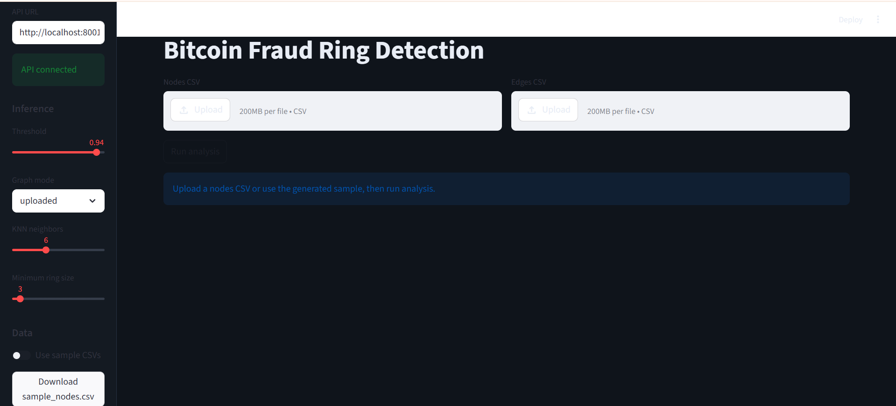
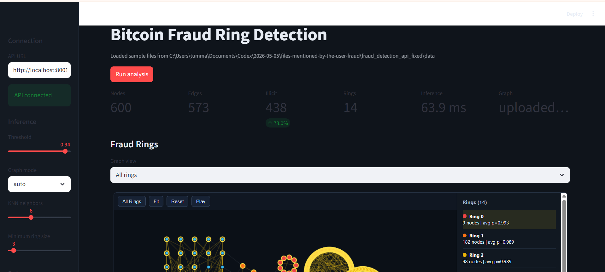
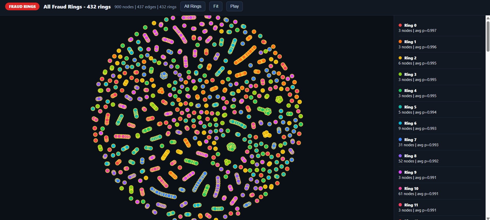
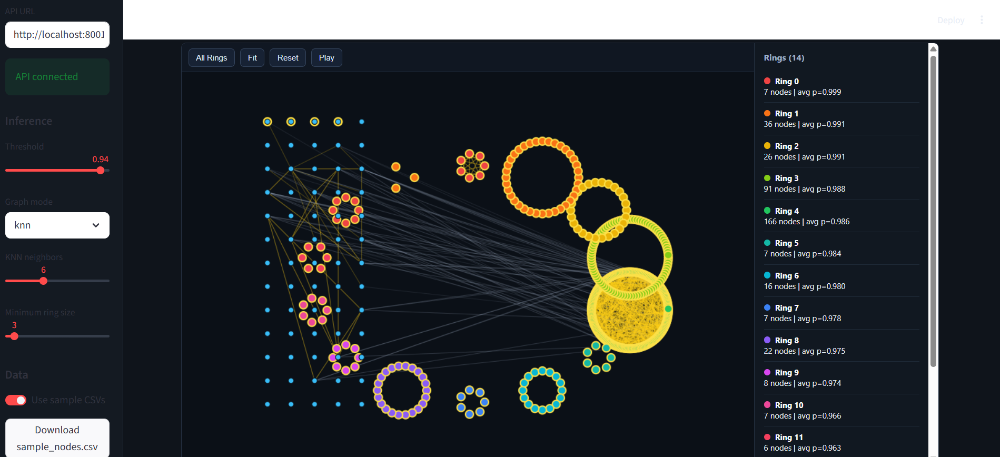
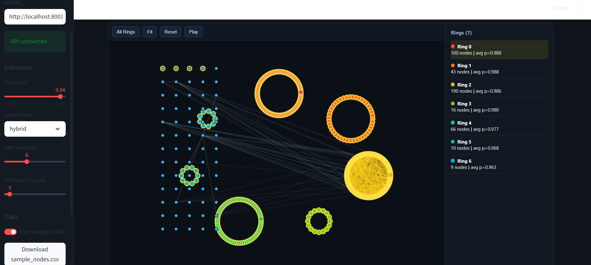
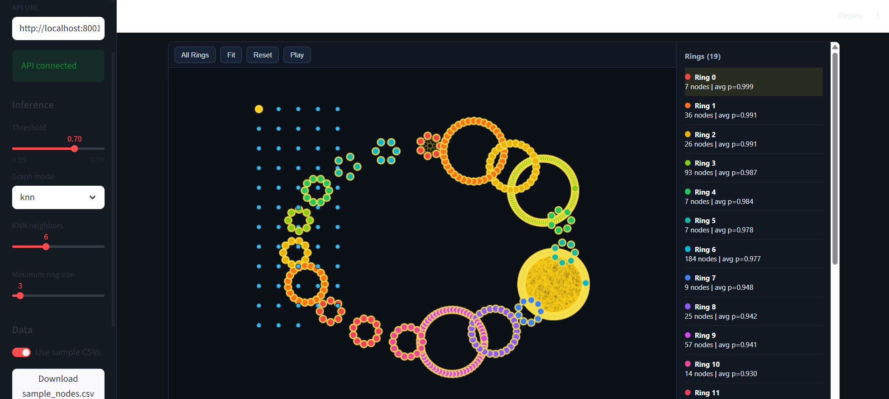
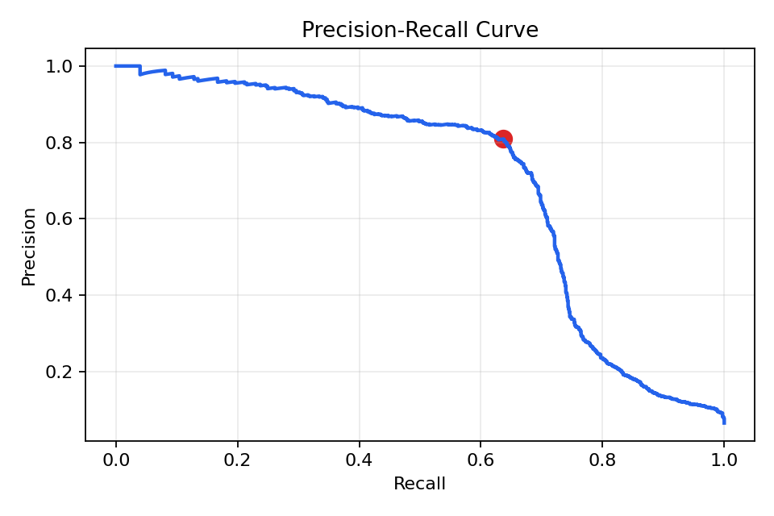

# Graph-Based Fraud Ring Detection using Graph Neural Networks

A full-stack Graph Neural Network (GNN) system for detecting coordinated cryptocurrency fraud rings in Bitcoin transaction networks using GraphSAGE, FastAPI, and Streamlit.

---

# Overview

Traditional fraud detection systems evaluate transactions independently. However, cryptocurrency fraud often occurs through coordinated transaction networks where suspicious behaviour only becomes visible when analysing the structure of the transaction graph itself.

This project models Bitcoin transactions as a graph and applies a Graph Neural Network (GraphSAGE) to identify:

* Illicit transactions
* Coordinated fraud rings
* Suspicious transaction clusters
* High-risk connected components

The system includes:

* GraphSAGE-based fraud prediction
* Fraud ring discovery using connected-component analysis
* Interactive graph visualisation
* FastAPI backend
* Streamlit frontend
* Configurable graph-construction modes
* Real-time inference pipeline

---

# Key Features

* Graph Neural Network (GraphSAGE) fraud detection
* Fraud ring discovery using connected-component analysis
* Interactive force-directed graph visualisation
* Real-time inference through FastAPI
* Streamlit web application
* Configurable graph modes:

  * Auto
  * KNN
  * Hybrid
* Adjustable fraud threshold
* Adjustable KNN neighbours
* Adjustable minimum ring size
* CSV upload support
* Full preprocessing + inference pipeline

---

# System Architecture

The system is divided into three layers:

1. Frontend (Streamlit)
2. Backend API (FastAPI)
3. GNN Inference Pipeline (PyTorch Geometric)

---

# Inference Workflow

1. User uploads transaction CSVs
2. Streamlit sends request to FastAPI
3. Backend preprocesses transaction graph
4. GraphSAGE performs inference
5. Fraud probabilities are generated
6. Connected fraud rings are identified
7. Interactive visualisation is rendered

---

# Tech Stack

| Component        | Technology          |
| ---------------- | ------------------- |
| Language         | Python              |
| Deep Learning    | PyTorch             |
| GNN Framework    | PyTorch Geometric   |
| API Backend      | FastAPI + Uvicorn   |
| Frontend         | Streamlit           |
| Graph Processing | NetworkX            |
| Visualisation    | Plotly + Matplotlib |
| ML Utilities     | Scikit-learn        |
| Data Processing  | NumPy + Pandas      |

---

# Model Architecture

The model uses GraphSAGE with four graph-convolution layers.

| Layer       | Input Dim | Output Dim |
| ----------- | --------- | ---------- |
| SAGEConv 1  | 166       | 256        |
| SAGEConv 2  | 256       | 128        |
| SAGEConv 3  | 128       | 64         |
| SAGEConv 4  | 64        | 32         |
| Linear Head | 32        | 1          |

Additional techniques used:

* Batch Normalization
* Dropout (0.4)
* Focal Loss
* Class-weight balancing
* Temporal train-test split

Total Parameters: **168,514**

---

# Dataset

This project uses the Elliptic Bitcoin Dataset, a real-world cryptocurrency transaction graph dataset released by Elliptic and MIT.

Dataset contents:

* Bitcoin transaction features
* Directed transaction edges
* Illicit / licit labels

### Dataset Statistics

| Metric            | Value   |
| ----------------- | ------- |
| Transactions      | 203,769 |
| Edges             | 234,355 |
| Features per node | 166     |
| Time Steps        | 49      |

---

# Input Format

## Nodes CSV (Required)

Required columns:

* txId
* time_step
* f0 ... f164

---

## Edges CSV (Optional)

Required columns:

* txId1
* txId2

If omitted, the system automatically builds a KNN graph.

---

# Inference Parameters

## 1. Fraud Threshold

Controls the fraud classification boundary.

* Higher threshold:

  * fewer false positives
  * stricter fraud detection

* Lower threshold:

  * more sensitive
  * more suspicious nodes flagged

Default threshold:

```text
0.94
```

---

## 2. Graph Mode

### Auto

Uses real transaction edges if provided.

### KNN

Builds graph using nearest neighbours in feature space.

### Hybrid

Combines real transaction edges with KNN edges.

---

## 3. KNN Neighbours

Controls graph density in KNN/hybrid modes.

Lower values:

* sparse graph
* localized structure

Higher values:

* dense graph
* smoother predictions

---

## 4. Minimum Ring Size

Filters small connected components.

Example:

* minimum ring size = 3
* ignores isolated suspicious pairs

---

# Application Screenshots

## Home Interface



---

## Analysis Dashboard



---

## Full Fraud Ring Visualisation



---

## KNN Graph Mode



---

## Hybrid Graph Mode



---

## Threshold Sensitivity Example

Lowering threshold increases detected suspicious nodes.



---

## Precision Recall Curve



---

# Results

## Model Performance

| Metric  | Score |
| ------- | ----- |
| ROC-AUC | 0.903 |
| PR-AUC  | 0.679 |

---

## Fraud Ring Detection Results

The system identified multiple suspicious transaction clusters, including several large-scale coordinated fraud rings with high average fraud probability scores.

Example observations from inference:

| Metric                         | Value     |
| ------------------------------ | --------- |
| Largest Ring Size              | 182 Nodes |
| Average Fraud Probability      | 98.9%     |
| Interactive Ring Visualisation | Supported |
| Real-Time Inference            | Supported |

---

# Example Output

The system provides:

* Fraud probability for each transaction
* Ring detection table
* Interactive graph visualisation
* Connected fraud clusters
* Ring-wise probability summaries

---

# Running the Project

## 1. Clone Repository

```bash
git clone <repo-url>
cd fraud_detection_api_fixed
```

---

## 2. Create Virtual Environment

```bash
python -m venv venv
```

Activate environment:

### Windows

```bash
venv\Scripts\activate
```

### Linux/Mac

```bash
source venv/bin/activate
```

---

## 3. Install Requirements

```bash
pip install -r requirements.txt
```

---

# Running Backend

```bash
cd api
uvicorn main:app --reload --port 8001
```

---

# Running Frontend

Open new terminal:

```bash
cd frontend
streamlit run app.py
```

---

# Open Application

```text
http://localhost:8501
```

---

# Folder Structure

```text
fraud_detection_api_fixed/
│
├── api/                            # FastAPI backend
├── core/                           # Main preprocessing + inference pipeline
├── frontend/                       # Streamlit frontend
├── model/                          # GraphSAGE architecture
├── artifacts/                      # Saved trained model + normalization files
├── data/                           # Sample datasets
├── notebooks/                      # Training notebooks
├── screenshots/                    # Project screenshots
├── report/                         # Full technical documentation
│
├── requirements.txt
├── README.md
└── .gitignore
```

---

# Practical Applications

This architecture can be extended beyond Bitcoin fraud detection into:

* AML (Anti-Money Laundering)
* Banking fraud detection
* Financial transaction monitoring
* DeFi analytics
* Blockchain intelligence
* Organized fraud detection
* Payment-network anomaly detection

---

# Future Improvements

Potential future enhancements:

* Graph Attention Networks (GAT)
* Temporal GNNs
* Neo4j graph backend
* Real-time streaming inference
* Distributed graph processing
* Analyst workflow integration
* Batch asynchronous inference

---

# Full Documentation

Detailed technical documentation, training methodology, parameter analysis, and complete project discussion are available in the `/report` folder.

---

# Author

Sriram Tummala

---

# License

This project is intended for academic and research purposes.
